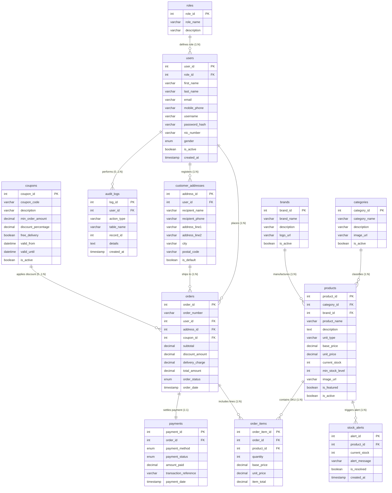

# SuperMart Database - Entity Relationship (ER) Diagram Specification
**Course Module:** Advanced Database Management Systems (ICT3222)  
**Database Name:** `supermart_db`  
**Total Tables:** 12 Tables  

---

## 1. Summary of All 12 Tables in the Database

| # | Table Name | Primary Key (PK) | Purpose / Entity Description |
|---|------------|------------------|------------------------------|
| 1 | `roles` | `role_id` | User access levels (Super Admin, Operational Manager, Customer) |
| 2 | `users` | `user_id` | System user accounts and profile credentials |
| 3 | `customer_addresses` | `address_id` | Delivery addresses saved by registered customers |
| 4 | `categories` | `category_id` | Product classifications (Vegetables, Fruits, Dairy, etc.) |
| 5 | `brands` | `brand_id` | Suppliers / Manufacturers / Brands (Anchor, Dilmah, etc.) |
| 6 | `products` | `product_id` | Supermarket product catalog, stock inventory, wholesale & retail pricing |
| 7 | `coupons` | `coupon_id` | Promotional discount and free-delivery promotional vouchers |
| 8 | `orders` | `order_id` | Customer checkout purchases, delivery totals, and statuses |
| 9 | `order_items` | `order_item_id` | Itemized line items within each order (Quantity, Cost, Retail, Subtotal) |
| 10 | `payments` | `payment_id` | Financial transaction records per completed order |
| 11 | `stock_alerts` | `alert_id` | Low inventory warnings generated when stock <= min_stock_level |
| 12 | `audit_logs` | `log_id` | Security and audit trail tracking price, status, and account changes |

---

## 2. Line-by-Line Table Connections & Cardinality Matrix

| Connection # | Parent Table (1) | Child Table (Many / One) | Foreign Key Column | Cardinality | Relationship Description |
|---|---|---|---|---|---|
| **1** | `roles` | `users` | `users.role_id` | **1 : N** (One-to-Many) | One role is assigned to many users; each user has exactly one role. |
| **2** | `users` | `customer_addresses` | `customer_addresses.user_id` | **1 : N** (One-to-Many) | One customer can register multiple delivery addresses. |
| **3** | `categories` | `products` | `products.category_id` | **1 : N** (One-to-Many) | One category contains many grocery products. |
| **4** | `brands` | `products` | `products.brand_id` | **1 : N** (One-to-Many) | One brand produces many products. |
| **5** | `users` | `orders` | `orders.user_id` | **1 : N** (One-to-Many) | One customer can place many orders over time. |
| **6** | `customer_addresses` | `orders` | `orders.address_id` | **1 : N** (One-to-Many) | One delivery address can be selected for multiple orders. |
| **7** | `coupons` | `orders` | `orders.coupon_id` | **0..1 : N** (Zero/One-to-Many) | A coupon can be used across multiple orders; an order optionally has 1 coupon. |
| **8** | `orders` | `order_items` | `order_items.order_id` | **1 : N** (One-to-Many) | One order contains one or more line items (deleting order cascades items). |
| **9** | `products` | `order_items` | `order_items.product_id` | **1 : N** (One-to-Many) | One product can be purchased in many order line items. |
| **10** | `orders` | `payments` | `payments.order_id` | **1 : 1** (One-to-One) | Each order has exactly one payment record (`order_id` is UNIQUE). |
| **11** | `products` | `stock_alerts` | `stock_alerts.product_id` | **1 : N** (One-to-Many) | One product can trigger multiple low-stock threshold alerts over time. |
| **12** | `users` | `audit_logs` | `audit_logs.user_id` | **0..1 : N** (Zero/One-to-Many) | One user triggers many audit actions (nullable for system background triggers). |

> **Special Note for ER Diagram:**  
> `orders` and `products` have a **Many-to-Many (M : N)** relationship. It is resolved through the associative/junction entity **`order_items`**:  
> `orders` (1) ──────< (M) `order_items` (M) >────── (1) `products`

---

## 3. Detailed Entity Attributes & Keys for Drawing

### 1. `roles`
* **Primary Key (PK):** `role_id` (INT)
* **Attributes:** `role_name` (VARCHAR, UNIQUE), `description` (VARCHAR)
* **Connected to:** `users` (1:N)

### 2. `users`
* **Primary Key (PK):** `user_id` (INT)
* **Foreign Key (FK):** `role_id` (references `roles.role_id`)
* **Attributes:** `first_name`, `last_name`, `email` (UNIQUE), `mobile_phone` (UNIQUE), `username` (UNIQUE), `password_hash`, `nic_number`, `gender`, `is_active`, `created_at`, `updated_at`
* **Connected to:**
  * `roles` (Child of `roles`, N:1)
  * `customer_addresses` (Parent to `customer_addresses`, 1:N)
  * `orders` (Parent to `orders`, 1:N)
  * `audit_logs` (Parent to `audit_logs`, 1:N)

### 3. `customer_addresses`
* **Primary Key (PK):** `address_id` (INT)
* **Foreign Key (FK):** `user_id` (references `users.user_id`)
* **Attributes:** `recipient_name`, `recipient_phone`, `address_line1`, `address_line2`, `city`, `postal_code`, `is_default`, `created_at`
* **Connected to:**
  * `users` (Child of `users`, N:1)
  * `orders` (Parent to `orders`, 1:N)

### 4. `categories`
* **Primary Key (PK):** `category_id` (INT)
* **Attributes:** `category_name` (VARCHAR, UNIQUE), `description`, `image_url`, `is_active`
* **Connected to:** `products` (1:N)

### 5. `brands`
* **Primary Key (PK):** `brand_id` (INT)
* **Attributes:** `brand_name` (VARCHAR, UNIQUE), `description`, `logo_url`, `is_active`
* **Connected to:** `products` (1:N)

### 6. `products`
* **Primary Key (PK):** `product_id` (INT)
* **Foreign Keys (FK):**
  * `category_id` (references `categories.category_id`)
  * `brand_id` (references `brands.brand_id`)
* **Attributes:** `product_name`, `description`, `unit_type`, `base_price` (wholesale cost), `unit_price` (selling retail price), `current_stock`, `min_stock_level`, `image_url`, `is_featured`, `is_active`, `created_at`, `updated_at`
* **Connected to:**
  * `categories` (Child of `categories`, N:1)
  * `brands` (Child of `brands`, N:1)
  * `order_items` (Parent to `order_items`, 1:N)
  * `stock_alerts` (Parent to `stock_alerts`, 1:N)

### 7. `coupons`
* **Primary Key (PK):** `coupon_id` (INT)
* **Attributes:** `coupon_code` (UNIQUE), `description`, `min_order_amount`, `discount_percentage`, `free_delivery`, `valid_from`, `valid_until`, `is_active`
* **Connected to:** `orders` (1:N)

### 8. `orders`
* **Primary Key (PK):** `order_id` (INT)
* **Foreign Keys (FK):**
  * `user_id` (references `users.user_id`)
  * `address_id` (references `customer_addresses.address_id`)
  * `coupon_id` (references `coupons.coupon_id`, NULLable)
* **Attributes:** `order_number` (UNIQUE), `subtotal`, `discount_amount`, `delivery_charge`, `total_amount`, `order_status`, `order_date`
* **Connected to:**
  * `users` (Child of `users`, N:1)
  * `customer_addresses` (Child of `customer_addresses`, N:1)
  * `coupons` (Child of `coupons`, N:1)
  * `order_items` (Parent to `order_items`, 1:N)
  * `payments` (Parent to `payments`, 1:1)

### 9. `order_items` (Junction Table for Orders & Products)
* **Primary Key (PK):** `order_item_id` (INT)
* **Foreign Keys (FK):**
  * `order_id` (references `orders.order_id`)
  * `product_id` (references `products.product_id`)
* **Attributes:** `quantity`, `base_price` (snapshot wholesale cost at purchase), `unit_price` (snapshot retail price at purchase), `item_total`
* **Connected to:**
  * `orders` (Child of `orders`, N:1)
  * `products` (Child of `products`, N:1)

### 10. `payments`
* **Primary Key (PK):** `payment_id` (INT)
* **Foreign Key (FK):** `order_id` (references `orders.order_id`, UNIQUE)
* **Attributes:** `payment_method` (CASH_ON_DELIVERY / CARD_PAYMENT), `payment_status` (PENDING / COMPLETED / FAILED), `amount_paid`, `transaction_reference`, `payment_date`
* **Connected to:** `orders` (1:1 relationship with `orders`)

### 11. `stock_alerts`
* **Primary Key (PK):** `alert_id` (INT)
* **Foreign Key (FK):** `product_id` (references `products.product_id`)
* **Attributes:** `current_stock`, `alert_message`, `is_resolved`, `created_at`
* **Connected to:** `products` (Child of `products`, N:1)

### 12. `audit_logs`
* **Primary Key (PK):** `log_id` (INT)
* **Foreign Key / Ref (FK):** `user_id` (references `users.user_id`, NULLable)
* **Attributes:** `action_type`, `table_name`, `record_id`, `details`, `created_at`
* **Connected to:** `users` (Child of `users`, N:1)

---

## 4. Mermaid Visual ER Diagram

---

## 5. How to Generate in MySQL Workbench Automatically (Reverse Engineering)
If you wish to view the visual diagram directly in MySQL Workbench:
1. Open **MySQL Workbench**.
2. Click **Database** in the top menu -> **Reverse Engineer...** (or press `Ctrl + R`).
3. Select your stored connection (`localhost:3306`).
4. Select `supermart_db` from the database schema list.
5. Click **Next** -> **Execute** -> **Finish**.
6. MySQL Workbench will automatically lay out all 12 tables and draw the Crow's Foot relationship lines for you.
