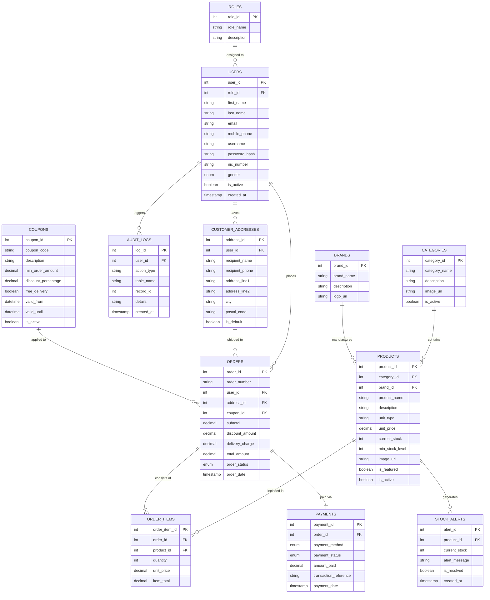

# ADVANCED DATABASE MANAGEMENT SYSTEMS (ICT3222)
## Mini Project: SuperMart Online Management System
### Comprehensive System Specification, User Task Sheet & ADBMS Integration Blueprint

---

## 1. System Overview & Architecture

**SuperMart Online** is a full-featured online supermarket platform built without any ORM (Object-Relational Mapping). It connects a modern React frontend to a Spring Boot backend powered strictly by raw SQL queries and `JdbcTemplate`, backed by MySQL 8.0+ incorporating advanced database concepts.

### High-Level 3-Tier Architecture
```
+-------------------------------------------------------------+
|                      PRESENTATION TIER                      |
|                React + Tailwind CSS SPA                     |
|  [Customer Portal]  [Operational Manager]  [Super Admin]    |
+------------------------------+------------------------------+
                               | REST API (JSON / HTTP)
+------------------------------v------------------------------+
|                     APPLICATION TIER                        |
|                  Spring Boot (Java 21)                      |
|      Strictly Pure JDBC / JdbcTemplate (NO ORM / JPA)       |
|  - Custom RowMappers                                        |
|  - Raw SQL PreparedStatements                               |
|  - CallableStatements (Stored Procedures & Functions)      |
|  - @Transactional ACID Transaction Boundaries              |
+------------------------------+------------------------------+
                               | TCP Connection Pool (HikariCP)
+------------------------------v------------------------------+
|                        DATA TIER                            |
|                        MySQL 8.0+                           |
|  - 3NF Normalized Schema (12 Tables)                        |
|  - 6 Views | 6 Procedures | 6 Functions                     |
|  - 6 Triggers | 6 Scheduled Events                          |
|  - B-Tree Composite Indexes & Query Optimization            |
|  - Audit Trail & Role-Based Database Security               |
+-------------------------------------------------------------+
```

---

## 2. User Roles & Detailed Task Breakdown

The system strictly supports **three (3) distinct user roles**:
1. **Customer** (Public / Self-Registered)
2. **Operational Manager** (Created exclusively by Super Admin)
3. **Super Admin** (Default Master Administrator)

---

### 2.1 Customer Role (Public / Shopper)

| Stage | Feature / Task | Detailed Functional Specification | ADBMS Concept Invoked |
| :--- | :--- | :--- | :--- |
| **Onboarding** | **Self Registration** | Form fields: First Name, Last Name, Email, Mobile Phone, Password.<br>Client-side & backend regex validation.<br>Checks uniqueness of email and mobile.<br>On success, navigates to Login page. | Stored Procedure: `sp_register_customer`<br>Trigger: `trg_after_user_insert_audit` |
| **Authentication** | **Customer Login** | Customer can enter **either Email OR Mobile Phone** as username, plus Password.<br>Verifies credentials against `users` table.<br>Issues authenticated session token. | Index: `idx_users_login_email`, `idx_users_login_phone` |
| **Profile** | **Profile Management** | View personal profile details.<br>Update First Name, Last Name, Mobile Phone, and Password. | Raw SQL Prepared UPDATE; Audited |
| **Browsing** | **Catalog & Search** | Browse foods, fresh produce, groceries, brands.<br>Search by product name, filter by brand & category.<br>Displays unit pricing (e.g. price per 100g or unit).<br>Shows dynamic stock badge ("In Stock" or "Out of Stock"). | View: `v_active_product_catalog`<br>Index: `idx_products_category`, `idx_products_brand` |
| **Shopping** | **Dynamic Quantity & Cart** | Select quantity in grams or units (e.g., 100g, 250g, 500g, 1kg).<br>Live subtotal recalculation based on unit price.<br>Prevent adding out-of-stock items.<br>Add to interactive shopping cart drawer.<br>Change item quantity in cart; dynamic total bill update. | Stored Function: `fn_is_product_in_stock` |
| **Checkout (Step 1)** | **Delivery Address** | Form automatically pre-fills Customer's Full Name and Mobile Number.<br>Takes Address Line 1, Address Line 2, and City.<br>Option to save address or choose previously saved addresses. | Stored Procedure: `sp_add_customer_address`<br>Table: `customer_addresses` |
| **Checkout (Step 2)** | **Payment Method Selection** | Choose **Cash on Delivery (COD)** or **Card Payment**.<br>Displays subtotal, delivery charge, and calculated total bill.<br>If Card Payment: card details input validation. | Table: `payments`<br>Stored Function: `fn_calculate_delivery_fee` |
| **Checkout (Step 3)** | **Coupon Application** | Customer clicks **"Add Coupon"** button.<br>Modal displays active coupons from database:<br>1. `FREEDEL3000`: Orders > Rs. 3,000 → Free Delivery.<br>2. `SAVE10PLUS`: Orders > Rs. 5,000 → 10% Discount + Free Delivery.<br>Customer enters code, clicks "Apply". System validates subtotal against coupon rules, recalculates total bill live. | View: `v_active_coupons`<br>Stored Function: `fn_calculate_coupon_discount` |
| **Order Placement** | **Final Checkout & Receipt** | Submits order within an atomic database transaction.<br>Inserts order line items, deducts inventory automatically, logs payment, and produces printable/downloadable receipt with Order Number, itemized bill, discounts, and payment status. | Stored Procedure: `sp_place_order_transaction`<br>Trigger: `trg_after_order_item_insert_deduct_stock`<br>Trigger: `trg_before_product_stock_check` |
| **History** | **Order History** | View past orders, payment receipts, order tracking statuses (Pending, Confirmed, Processing, Delivered). | View: `v_customer_order_history`<br>Stored Function: `fn_customer_lifetime_spending` |

---

### 2.2 Operational Manager Role (Operations & Inventory)

| Feature / Task | Detailed Functional Specification | ADBMS Concept Invoked |
| :--- | :--- | :--- |
| **Authentication** | Log in using **Username = Mobile Phone Number** and Password assigned by Super Admin.<br>Authentication validates `role_id = 2`. | Index: `idx_users_login_phone` |
| **Profile & Security** | Can update their First Name, Last Name, Email, and Password.<br>**STRICT RULE**: CANNOT change their assigned Username (mobile phone). | Table: `users`<br>RBAC constraints |
| **Dashboard Overview** | Real-time operational metrics: Active product count, total pending orders, low-stock warnings badge. | View: `v_low_stock_alerts` |
| **Stock Management & Restock** | View list of all products with stock indicators.<br>Identify items reaching minimum stock threshold.<br>Restock products by inputting additional stock quantity.<br>Audit log tracks who restocked what and when. | Stored Procedure: `sp_restock_product`<br>Trigger: `trg_after_product_stock_update_alert`<br>Trigger: `trg_before_product_stock_check` |
| **Product & Price Management** | Add new products (name, category, brand, unit price per 100g/unit, stock, image).<br>Update product unit prices.<br>Any price update automatically records old vs new price into audit trail. | Trigger: `trg_before_product_price_audit`<br>Table: `products` |
| **Coupon Management** | View existing coupons and active dates.<br>Create new promotional coupons (code, description, min order, discount %, free delivery flag, expiry).<br>Activate or deactivate coupons. | Table: `coupons`<br>View: `v_active_coupons`<br>Event: `evt_daily_cleanup_expired_coupons` |
| **Order Tracking** | View all customer orders.<br>Update order fulfillment status: `PENDING` → `CONFIRMED` → `PROCESSING` → `OUT_FOR_DELIVERY` → `DELIVERED`.<br>System records status change in audit log. | Trigger: `trg_after_order_status_update_audit`<br>Table: `orders` |

---

### 2.3 Super Admin Role (Master Control & Analytics)

| Feature / Task | Detailed Functional Specification | ADBMS Concept Invoked |
| :--- | :--- | :--- |
| **Authentication** | Log in with master credentials (`admin` / `admin123`).<br>Super Admin role (`role_id = 1`). | Table: `users` |
| **Profile & Security** | Admin can update their profile.<br>**SPECIAL PRIVILEGE**: Admin can change their own **Username** and **Password** at any time. | Table: `users` |
| **Manager Management** | **Add Operational Managers**:<br>Input fields: First Name, Last Name, Email, NIC Number, Mobile Phone, Gender.<br>**Auto-Fill Feature**: Mobile Phone is automatically set as the Manager's Username.<br>Admin assigns initial password.<br>System validates NIC format (Sri Lankan 9-digit+V/X or 12-digit).<br>Lists all operational managers with active/deactivate toggle. | Stored Procedure: `sp_create_operational_manager`<br>Stored Function: `fn_validate_nic_format`<br>Trigger: `trg_after_user_insert_audit` |
| **Analytics Dashboard** | Visual analytical charts & KPIs:<br>- Total Gross & Net Revenue.<br>- Daily Sales trends.<br>- Top Selling Products (by quantity and revenue).<br>- Total Registered Customers & Managers. | View: `v_daily_sales_summary`<br>View: `v_top_selling_products` |
| **System Audit Trail** | Searchable and filterable master audit log table.<br>Tracks every critical action across the system (User registration, logins, price modifications, stock updates, orders placed, order status transitions). | Table: `audit_logs`<br>Index: `idx_audit_created`, `idx_audit_action`<br>Event: `evt_daily_audit_snapshot` |
| **Monthly Reports** | Generate monthly executive revenue and order reports for management.<br>Export or print reports for specified year and month. | Stored Procedure: `sp_generate_monthly_report` |

---

## 3. Complete ADBMS Concepts Integration Matrix

This table maps where each database concept is implemented in the database and how the Spring Boot application calls it:

### 3.1 The Six (6) Views
| View Name | Primary Consumer | Purpose / Application Feature |
| :--- | :--- | :--- |
| `v_active_product_catalog` | Customer / Home Page | Product listing with joined brand and category names and computed `stock_status` ('In Stock' vs 'Out of Stock'). |
| `v_low_stock_alerts` | Operational Manager & Admin | Real-time alert list filtering products where `current_stock <= min_stock_level` and computing `units_needed`. |
| `v_customer_order_history` | Customer & Admin | Comprehensive view of customer orders joining user details, delivery fees, coupons, and payment statuses. |
| `v_daily_sales_summary` | Super Admin Dashboard | Analytical aggregation summarizing daily order counts, gross subtotals, discounts given, and net revenues. |
| `v_top_selling_products` | Super Admin Analytics | Product leaderboard aggregated from order line items ordered by units sold and revenue. |
| `v_active_coupons` | Checkout Page & Manager | Displays only valid, unexpired coupons currently available for checkout. |

### 3.2 The Six (6) Stored Procedures
| Procedure Name | Executed By | Purpose & Transactional Behavior |
| :--- | :--- | :--- |
| `sp_register_customer` | Customer Auth Service | Validates uniqueness of email and mobile, inserts into `users` with `ROLE_CUSTOMER`, returns generated user ID. |
| `sp_create_operational_manager` | Admin Manager Service | Admin-only security check, validates NIC with `fn_validate_nic_format`, sets username = mobile phone, creates manager. |
| `sp_restock_product` | Operational Manager | Safely increments stock quantity and creates an audit record of the restock event. |
| `sp_add_customer_address` | Customer Checkout | Inserts a new customer delivery address and sets default delivery flag. |
| `sp_place_order_transaction` | Customer Checkout Service | **ACID Transaction**: Verifies coupon, computes delivery fee, inserts order, creates payment record, and automatically **ROLLS BACK** on any SQL exception. |
| `sp_generate_monthly_report` | Admin Report Service | Aggregates revenue, delivery fees, and order counts for a designated Year/Month. |

### 3.3 The Six (6) Stored Functions
| Function Name | Return Type | Purpose in Application Logic |
| :--- | :--- | :--- |
| `fn_is_product_in_stock(product_id, qty)` | `TINYINT(1)` | Fast boolean check before adding to cart or confirming order. |
| `fn_calculate_delivery_fee(subtotal, free_flag)` | `DECIMAL(10,2)` | Returns `0.00` if subtotal >= 3000 or coupon offers free delivery; otherwise `350.00`. |
| `fn_calculate_coupon_discount(subtotal, code)` | `DECIMAL(10,2)` | Computes percentage discount if subtotal satisfies minimum order threshold. |
| `fn_customer_lifetime_spending(user_id)` | `DECIMAL(10,2)` | Calculates total lifetime spending across all non-cancelled orders of a customer. |
| `fn_validate_nic_format(nic)` | `TINYINT(1)` | Regex validation checking valid Sri Lankan NIC formats (9 digits + V/X or 12 digits). |
| `fn_get_order_total_items(order_id)` | `INT` | Sums up item quantities for an order summary badge. |

### 3.4 The Six (6) Database Triggers
| Trigger Name | Timing & Event | Purpose / Business Rule Enforced |
| :--- | :--- | :--- |
| `trg_after_order_item_insert_deduct_stock` | `AFTER INSERT ON order_items` | Automatically deducts purchased quantity from `products.current_stock`. |
| `trg_after_product_stock_update_alert` | `AFTER UPDATE ON products` | Detects when stock drops to or below `min_stock_level` and inserts an alert into `stock_alerts`. |
| `trg_before_product_price_audit` | `BEFORE UPDATE ON products` | Detects price modifications and writes old and new prices into `audit_logs`. |
| `trg_after_user_insert_audit` | `AFTER INSERT ON users` | Automatically records every new user registration or manager creation into `audit_logs`. |
| `trg_before_product_stock_check` | `BEFORE UPDATE ON products` | Integrity check: Throws `SIGNAL SQLSTATE '45000'` if stock would become negative. |
| `trg_after_order_status_update_audit` | `AFTER UPDATE ON orders` | Automatically logs order status transitions (e.g. `PENDING` to `DELIVERED`). |

### 3.5 The Six (6) Scheduled Database Events
| Event Name | Schedule | Purpose |
| :--- | :--- | :--- |
| `evt_daily_cleanup_expired_coupons` | `EVERY 1 DAY` | Sets `is_active = FALSE` on coupons that have passed their expiration date. |
| `evt_hourly_stock_alert_check` | `EVERY 1 HOUR` | Automatically marks stock alerts as resolved once the product has been restocked above minimum level. |
| `evt_daily_audit_snapshot` | `EVERY 1 DAY` | Generates a daily summary log record of completed orders and revenue. |
| `evt_monthly_purge_old_audit_logs` | `EVERY 1 MONTH` | Automatically deletes audit logs older than 180 days to maintain optimal query performance. |
| `evt_weekly_zero_stock_flag` | `EVERY 1 WEEK` | Logs system warnings for products that have remained at zero stock for more than 14 days. |
| `evt_cancel_stale_pending_orders` | `EVERY 1 DAY` | Automatically sets status to `CANCELLED` for unpaid pending orders older than 48 hours. |

### 3.6 Indexing & Query Optimization
- **`idx_products_category`, `idx_products_brand`, `idx_products_name`**: Accelerates catalog filtering and search queries.
- **`idx_products_active_stock`**: Composite index on `(is_active, current_stock)` for instant "In Stock" queries.
- **`idx_orders_user_id`, `idx_orders_date`, `idx_orders_status`**: Optimizes customer order history and analytical aggregation.
- **`idx_users_login_email`, `idx_users_login_phone`, `idx_users_username`**: Fast B-Tree lookups for dual-login (Email or Phone).
- **`idx_audit_created`, `idx_audit_action`**: Fast date-range filtering in the Admin Audit Log viewer.

---

## 4. Entity Relationship (ER) Diagram



---

## 5. Relational Schema Mapping (Formal Academic Notation)

In standard database design notation, **Primary Keys** are underlined, and **Foreign Keys** are annotated with *(FK)*:

1. **ROLES** (<ins>role_id</ins>, role_name, description)
2. **USERS** (<ins>user_id</ins>, role_id*(FK)*, first_name, last_name, email, mobile_phone, username, password_hash, nic_number, gender, is_active, created_at, updated_at)
   - *Foreign Key*: `role_id` REFERENCES `ROLES(role_id)`
3. **CUSTOMER_ADDRESSES** (<ins>address_id</ins>, user_id*(FK)*, recipient_name, recipient_phone, address_line1, address_line2, city, postal_code, is_default, created_at)
   - *Foreign Key*: `user_id` REFERENCES `USERS(user_id)` ON DELETE CASCADE
4. **CATEGORIES** (<ins>category_id</ins>, category_name, description, image_url, is_active)
5. **BRANDS** (<ins>brand_id</ins>, brand_name, description, logo_url)
6. **PRODUCTS** (<ins>product_id</ins>, category_id*(FK)*, brand_id*(FK)*, product_name, description, unit_type, unit_price, current_stock, min_stock_level, image_url, is_featured, is_active, created_at, updated_at)
   - *Foreign Keys*: `category_id` REFERENCES `CATEGORIES(category_id)`, `brand_id` REFERENCES `BRANDS(brand_id)`
7. **COUPONS** (<ins>coupon_id</ins>, coupon_code, description, min_order_amount, discount_percentage, free_delivery, valid_from, valid_until, is_active)
8. **ORDERS** (<ins>order_id</ins>, order_number, user_id*(FK)*, address_id*(FK)*, coupon_id*(FK)*, subtotal, discount_amount, delivery_charge, total_amount, order_status, order_date)
   - *Foreign Keys*: `user_id` REFERENCES `USERS(user_id)`, `address_id` REFERENCES `CUSTOMER_ADDRESSES(address_id)`, `coupon_id` REFERENCES `COUPONS(coupon_id)`
9. **ORDER_ITEMS** (<ins>order_item_id</ins>, order_id*(FK)*, product_id*(FK)*, quantity, unit_price, item_total)
   - *Foreign Keys*: `order_id` REFERENCES `ORDERS(order_id)` ON DELETE CASCADE, `product_id` REFERENCES `PRODUCTS(product_id)`
10. **PAYMENTS** (<ins>payment_id</ins>, order_id*(FK)*, payment_method, payment_status, amount_paid, transaction_reference, payment_date)
    - *Foreign Key*: `order_id` REFERENCES `ORDERS(order_id)` ON DELETE CASCADE
11. **AUDIT_LOGS** (<ins>log_id</ins>, user_id, action_type, table_name, record_id, details, created_at)
12. **STOCK_ALERTS** (<ins>alert_id</ins>, product_id*(FK)*, current_stock, alert_message, is_resolved, created_at)
    - *Foreign Key*: `product_id` REFERENCES `PRODUCTS(product_id)` ON DELETE CASCADE

---

## 6. Implementation Strategy & Next Steps

This document serves as the single source of truth for the system implementation. The next phase will execute the development in two coordinated steps:

1. **Spring Boot Pure JDBC Backend (`backend/`)**:
   - Database configuration in `application.properties` (connecting to `supermart_db`).
   - Repository layer implemented strictly with `JdbcTemplate` / `NamedParameterJdbcTemplate` and direct SQL queries (NO ORM).
   - Calling stored procedures (`SimpleJdbcCall` / `CallableStatement`) and querying views.
   - Restful API controllers for Auth, Products, Cart, Checkout, Manager Operations, and Admin Analytics.

2. **React + Tailwind CSS Frontend (`frontend/`)**:
   - Modern, responsive UI with customized color palettes and micro-animations.
   - Three distinct dashboard layouts:
     - **Customer**: Home, Search & Filter, Product Cards with 100g/unit pricing, Cart Drawer, 3-section Checkout, Receipt Modal, Profile.
     - **Operational Manager**: Stock Monitoring, Restock Modal, Coupon Manager, Order Fulfillment.
     - **Super Admin**: Analytics Charts, Operational Manager Creator (auto-filling mobile as username), Master Audit Trail, Monthly Report Generator.
